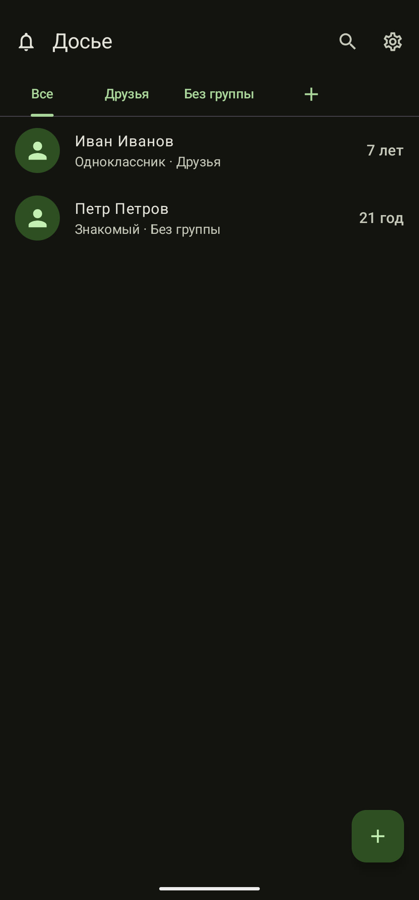
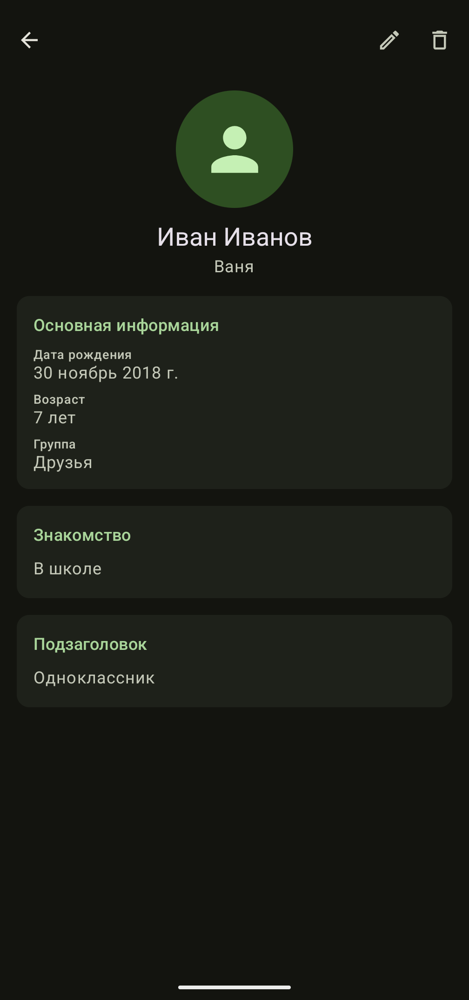
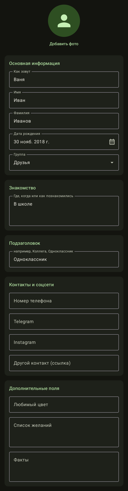
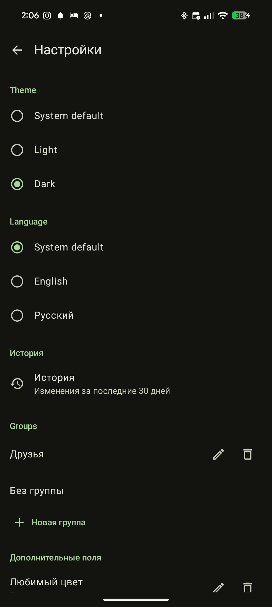
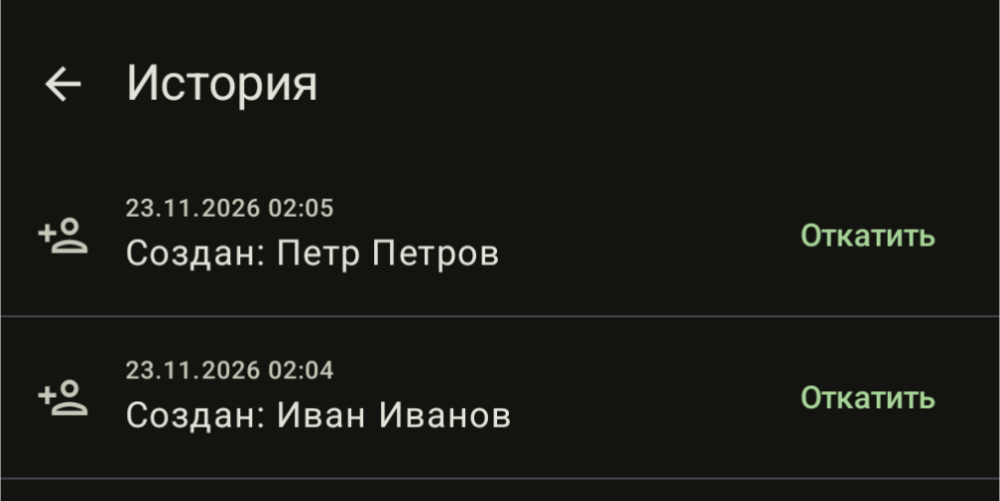
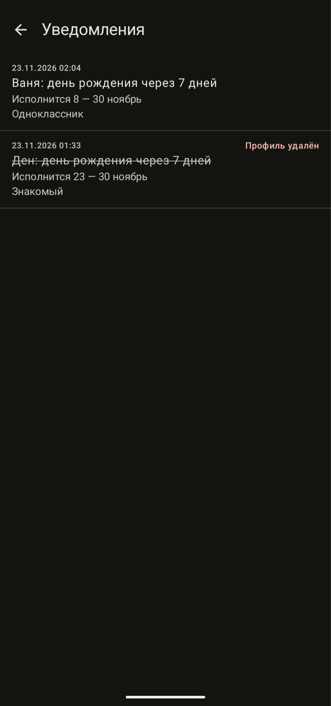

# Profiles / Досье app

An app for people's profiles, to keep track of their birthdays, favorite things, and other info that can easily be forgotten

## Features

* Person's profile
* Persons' grouping
* Custom fields
* Wishlist field
* Birthday notifications
* Notification history
* Change history with revert
* Light and dark themes
* English and Russian languages

## Screens

* **Main Screen** containing:
    * Search
    * Groups tabs
    * List of persons in selected tab
    * Navigation to other screens
* **Profile Screen** containing:
    * Picture (Avatar)
    * Fullname
    * Birthdate
    * Where you met this person
    * Group to which the person belongs
    * Contacts with quick actions
    * Some facts
    * Custom fields (info)
* **Edit Person Screen** containing:
    * All the person info fields, but editable
* **Settings Screen** containing:
    * Theme settings
    * Language settings
    * Groups settings
    * Custom fields settings
    * History
* **History Screen** containing:
    * Changes made in the last 30 days
    * Revert button for each change
* **Notifications Screen** containing:
    * List of sent birthday reminders

## Screenshots

  
  
  
  
  
  

## Running instructions

Download and install app (You have to have `Install from other sources` setting enabled)